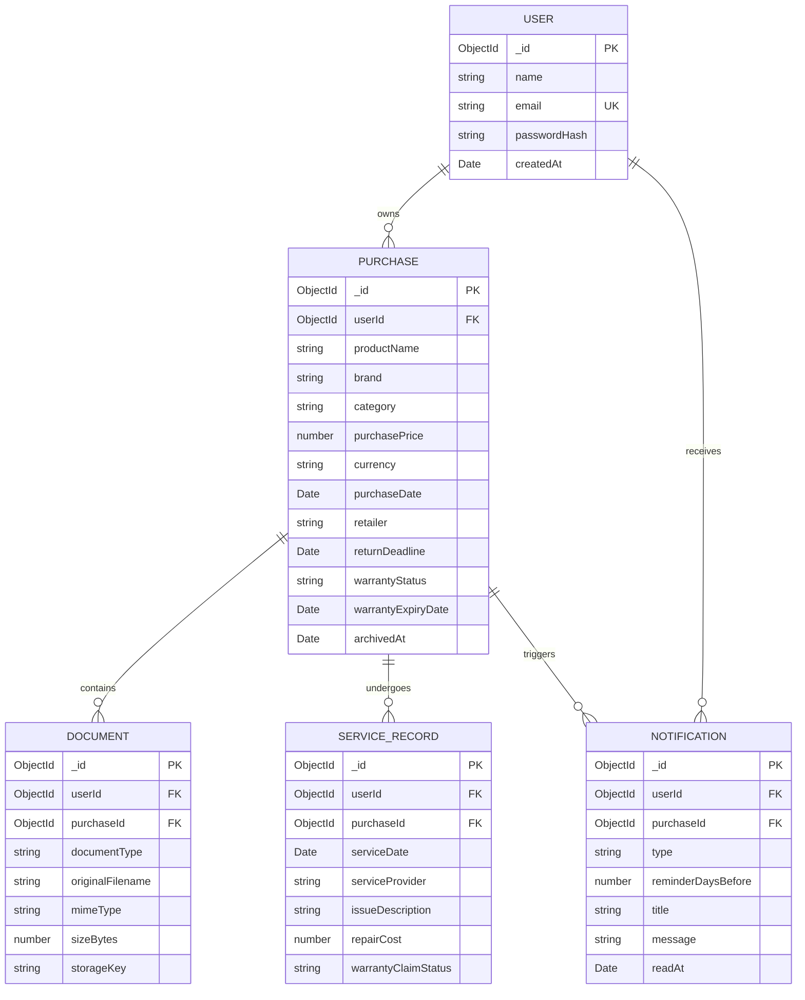

# ProofCart System Architecture

## 1. High-Level Architecture Overview

ProofCart is designed as a **feature-based modular monolith** built with TypeScript across both the client and server.

```
┌────────────────────────────────────────────────────────┐
│                   React Client (Vite)                  │
│   TanStack Query  •  React Hook Form  •  Tailwind CSS  │
└───────────────────────────┬────────────────────────────┘
                            │ HTTP / REST (/api/v1)
                            │ Dual-Auth: HttpOnly Cookies + Bearer Token
┌───────────────────────────▼────────────────────────────┐
│                  Express.js / Node.js                  │
│  Helmet • CORS • RateLimit • Pino • Auth Middleware    │
├────────────────────────────────────────────────────────┤
│ Modules: Auth | Purchases | Documents | Services |     │
│          Dashboard | Deadlines | Notifications         │
├────────────────────────────────────────────────────────┤
│ Services (Authoritative Business Logic)                │
│ Date Engine  •  Storage Adapter  •  Reminder Scheduler │
└─────────────┬───────────────────────────┬──────────────┘
              │                           │
              ▼                           ▼
      MongoDB Database            Private Storage
   (Mongoose Schemas & Indexes)   (Local Disk / Cloudinary)
```

---

## 2. Key Architectural Decisions & Solutions

### A. Dual-Mode Authentication (Vercel + Render Compatibility)
**The Problem:** Modern browsers (Safari ITP, Chrome Privacy Sandbox, Brave) restrict third-party cross-site cookies by default. When the frontend is hosted on `*.vercel.app` and the API is hosted on `*.onrender.com`, traditional HttpOnly cookies can be blocked, breaking login sessions.

**The Architectural Solution:** ProofCart implements **dual-mode authentication**:
1. When a user registers or logs in, the server sets an `HttpOnly`, `SameSite=none`, `Secure` session cookie named `proofcart_session`.
2. Simultaneously, the server returns the JWT token in the JSON response payload.
3. The client Axios interceptor captures the token and attaches `Authorization: Bearer <token>` to requests while maintaining `withCredentials: true`.
4. The server authentication middleware inspects the cookie first, falling back to the Bearer header if the cookie was suppressed by the browser.
5. This delivers seamless security in both localhost same-origin development and production cross-origin deployments.

---

### B. Private Document Vault Architecture
**The Problem:** Consumer purchase receipts and invoices contain sensitive personal data (names, home addresses, payment card details). Exposing documents via public URLs violates user privacy and creates security risks.

**The Architectural Solution:**
1. **Server-Side Storage Adapter (`IStorageProvider`):** Documents are stored with cryptographically random keys in a private directory (`uploads/documents/`) inaccessible via static HTTP serving.
2. **Authorized Streaming Endpoint:** Files can only be downloaded through `GET /api/v1/documents/:id/download`.
3. **Ownership Verification:** Before initiating the file stream, the server verifies that the document belongs to the authenticated user's purchase. If an unauthorized user attempts to access the file ID, the API returns a generic `404 DOCUMENT_NOT_FOUND` (preventing IDOR and resource enumeration).
4. **Failure Rollback:** If database persistence fails after file upload, the storage provider immediately unlinks the stored file, preventing orphaned storage leaks.

---

### C. Date & Warranty Engine
**Rules & Policies:**
1. **UTC Normalization:** All date-only fields (`purchaseDate`, `warrantyExpiryDate`, `returnDeadline`) are normalized to UTC midnight (`00:00:00.000Z`).
2. **Month-End Clamping:** When adding calendar months to a date (e.g. 1 month to January 31), the target month's maximum valid day is calculated:
   - Non-leap year: `2026-01-31` + 1 month = `2026-02-28`.
   - Leap year: `2024-01-31` + 1 month = `2024-02-29`.
3. **Precedence Policy:** Explicit dates entered by the user or provided by manufacturers always take precedence over automated durations.
4. **Inclusive Expiry Day Policy:** A warranty with an expiry date of `YYYY-MM-DD` remains valid and `ACTIVE` through the entire calendar day (until `23:59:59.999Z`).

---

### D. Multi-Currency Handling in Analytics
Different currencies (INR, USD, EUR) are never mathematically summed together on the dashboard.
The backend aggregation pipeline groups purchases by currency code first (`{ currency: 'INR', amount: 90000 }`, `{ currency: 'USD', amount: 200 }`), ensuring dashboard figures remain mathematically accurate and transparent.

---

### E. Idempotent Scheduled Reminders
To notify users before warranties or return windows expire without generating duplicate notifications:
- A compound unique index is applied on the notifications collection:
  `{ purchaseId: 1, type: 1, reminderDaysBefore: 1 }` (unique: true).
- The scheduled `node-cron` background worker scans for active purchases within 30-day, 7-day, and 1-day windows.
- Any attempt to create a notification that has already been generated triggers a duplicate key catch (`E11000`), ensuring complete idempotency even if the server restarts or catches up after downtime.

---

## 3. Database Schema Overview


